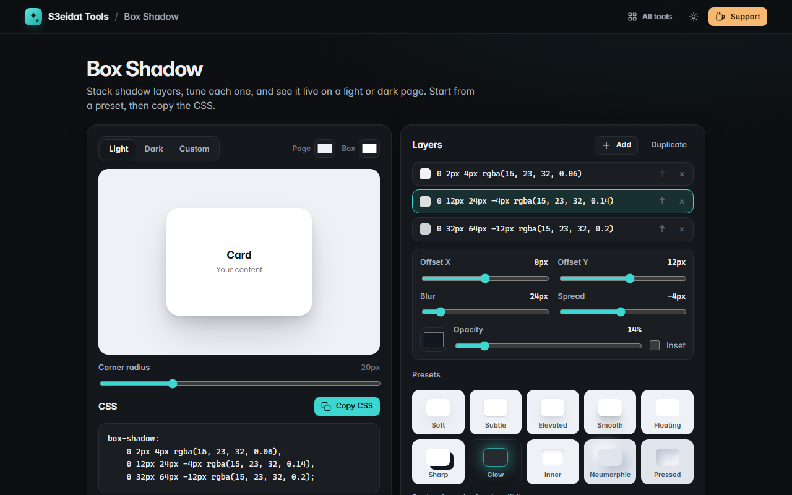

# Box Shadow

> Layered CSS box-shadow generator with a live preview. Free, private, and it runs entirely in your browser.

### ▶ [Open Box Shadow](https://s3eidat.github.io/box-shadow/)



## Features

- **Multiple shadow layers**: add, duplicate, reorder and delete
- Per layer: **offset X/Y, blur, spread, color, opacity and inset**
- **Live preview** on a light, dark or custom page and box color, with adjustable corner radius
- **10 presets**: soft, subtle, elevated, smooth (6-layer), floating, sharp, glow, inner, neumorphic and pressed
- **Paste an existing `box-shadow`** to edit it (any CSS color: hex, rgb, hsl, names…)
- **Copy CSS**, formatted one layer per line; your work is remembered on this device

## Privacy

Nothing you make leaves your device. There is no server, no account, no analytics.
The page ships with a strict Content-Security-Policy (`connect-src 'self'`), so the browser
itself blocks any attempt to send data anywhere.

## Run it yourself

It's plain HTML, CSS and JavaScript with no build step:

```bash
git clone https://github.com/s3eidat/box-shadow
cd box-shadow
python -m http.server 8000
```

Then open http://localhost:8000.

## Support

If this saved you time, **[buy me a coffee ☕](https://s3eidat.github.io/coffee/)**. It keeps every tool free.

---

Part of **[S3eidat Tools](https://s3eidat.github.io/)**: 100+ free, private tools that run in your browser. MIT licensed.
